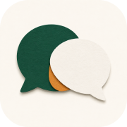
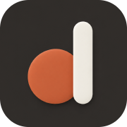
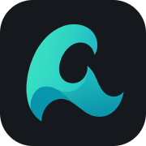

  <h1>Hi, I'm Jeanie 👋</h1>
  
Product Engineer &amp; Independent App Developer

  
I make apps that are useful, a little playful, and thoughtfully built.

  
Seoul · <a href="https://jeanie.dev">Website</a>

## Things I've built

  
  <strong><a href="https://organizly.org/">Organizly</a></strong> 
  A personal organizer for tasks, projects, and notes across iOS, macOS, and watchOS. Independently designed, developed, and shipped without a custom backend or account system. 
  SwiftUI · SwiftData · CloudKit · StoreKit 2 
  <a href="https://organizly.org/">Website</a> · <a href="https://apps.apple.com/kr/app/organizly-task-notes/id6469131765">App Store</a>

 

  
  <strong><a href="https://github.com/jeaniecho/rehearse">Rehearse</a></strong> 
  An AI-powered conversation coach for difficult workplace conversations, with interactive simulations, voice practice, and personalized feedback. Built with a resilient offline fallback. 
  Flutter · Dart · Node.js · Cloudflare Workers · OpenAI · RevenueCat 
  <a href="https://github.com/jeaniecho/rehearse">View source</a> · <a href="https://apps.apple.com/us/app/rehearse-conversation-coach/id6808087516">App Store</a> · <a href="https://play.google.com/store/apps/details?id=app.rehearse.rehearse">Google Play</a>

 

  
  <strong><a href="https://apps.apple.com/kr/app/%EC%9A%B0%ED%8C%8C%EB%A3%A8-%EA%B0%80%EC%9D%B4%EB%93%9C-%EC%A1%B0%ED%95%A9-%EA%B3%84%EC%82%B0%EA%B8%B0/id6474457167">Wooparoo Guide</a></strong> 
  An independently built mobile reference app for a collection-based game. 
  <strong>25,000+</strong> downloads · <strong>3,000</strong> peak DAU · <strong>#4</strong> in the App Store Reference category 
  <a href="https://apps.apple.com/kr/app/%EC%9A%B0%ED%8C%8C%EB%A3%A8-%EA%B0%80%EC%9D%B4%EB%93%9C-%EC%A1%B0%ED%95%A9-%EA%B3%84%EC%82%B0%EA%B8%B0/id6474457167">App Store</a> · <a href="https://play.google.com/store/apps/details?id=dev.jeanie.wooparoo">Google Play</a>

 

  
  <strong><a href="https://apps.apple.com/gb/app/daymark-private-daily-log/id6810120421">Daymark</a></strong> 
  A private, offline calendar for recording personal events with customizable entry types, biometric app lock, and optional iCloud sync. No accounts, tracking, or third-party dependencies. 
  SwiftUI · SwiftData · CloudKit · Swift Charts · LocalAuthentication 
  <a href="https://apps.apple.com/gb/app/daymark-private-daily-log/id6810120421">App Store</a>

 

  
  <strong><a href="https://apps.apple.com/kr/app/%EC%95%8C%EB%A1%9C%EC%95%84-%EC%9B%90%EC%A0%95%EB%8C%80-%EC%88%99%EC%A0%9C-%EA%B2%BD%EB%A7%A4-%EA%B3%84%EC%82%B0%EA%B8%B0/id6752291694">Aloa</a></strong> 
  An unofficial Lost Ark companion for character lookups, roster task management, market information, and auction calculations using the official game API. 
  Flutter · Dart · Firebase · Hive · Lost Ark Open API 
  <a href="https://apps.apple.com/kr/app/%EC%95%8C%EB%A1%9C%EC%95%84-%EC%9B%90%EC%A0%95%EB%8C%80-%EC%88%99%EC%A0%9C-%EA%B2%BD%EB%A7%A4-%EA%B3%84%EC%82%B0%EA%B8%B0/id6752291694">App Store</a> · <a href="https://play.google.com/store/apps/details?id=dev.jeanie.aloa">Google Play</a>

 

  
  <strong><a href="https://github.com/jeaniecho/waggle">Waggle</a></strong> 
  A tiny, local-first macOS desktop companion for focus and breaks, built around native window management, event-driven animations, and privacy-conscious input handling. 
  SwiftUI · AppKit · macOS · <a href="https://github.com/jeaniecho/waggle">View source</a>

 

## What I work with

**Apple platforms**  
Swift · SwiftUI · AppKit · SwiftData · CloudKit

**Cross-platform & web**  
Flutter · Dart · Next.js

**Backend & infrastructure**  
Firebase · Node.js · Cloudflare Workers · OpenAI API

**Product & growth**  
StoreKit 2 · RevenueCat · Stripe · GA4 · BigQuery · Experimentation

**Engineering workflow**  
Python · AI-assisted development · Automated testing · Iterative delivery
