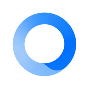
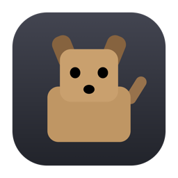

  <h1>Hi, I'm Jeanie 👋</h1>
  
Product Engineer &amp; Independent App Developer

  
I make apps that are useful, a little playful, and thoughtfully built.

  
Seoul · <a href="https://jeanie.dev">Website</a>

I take products from idea to design, development, release, and iteration, with a particular interest in native Apple experiences.

## Selected projects

<table>
  <tr>
    <td width="112" align="center" valign="middle">
      
    </td>
    <td valign="middle">
      <strong><a href="https://organizly.org/">Organizly</a></strong> 
      A personal organizer for tasks, projects, and notes across iOS, macOS, and watchOS. Independently designed, developed, and shipped without a custom backend or account system. 
      <code>SwiftUI</code> · <code>SwiftData</code> · <code>CloudKit</code> · <code>StoreKit 2</code> 
      <a href="https://organizly.org/">Website</a>
    </td>
  </tr>
  <tr>
    <td width="112" align="center" valign="middle">
      
    </td>
    <td valign="middle">
      <strong><a href="https://github.com/jeaniecho/waggle">Waggle</a></strong> 
      A tiny, local-first macOS desktop companion for focus and breaks, built around native window management, event-driven animations, and privacy-conscious input handling. 
      <code>SwiftUI</code> · <code>AppKit</code> · <code>macOS</code> 
      <a href="https://github.com/jeaniecho/waggle">View source</a>
    </td>
  </tr>
  <tr>
    <td width="112" align="center" valign="middle">
      
    </td>
    <td valign="middle">
      <strong><a href="https://apps.apple.com/kr/app/id6474457167">Wooparoo Guide</a></strong> 
      An independently built mobile reference app for a collection-based game. 
      <strong>25,000+</strong> downloads · <strong>3,000</strong> peak DAU · <strong>#4</strong> in the App Store Reference category 
      <a href="https://apps.apple.com/kr/app/id6474457167">App Store</a>
    </td>
  </tr>
</table>

## What I work with

| | |
|:--|:--|
| **Native development** | Swift, SwiftUI, AppKit |
| **Cross-platform & web** | Flutter, Dart, Next.js |
| **Infrastructure** | CloudKit, Firebase |
| **Product engineering** | Stripe, RevenueCat, GA4, BigQuery, experimentation |
| **Workflow & tooling** | Python, AI-assisted development, testing, iterative delivery |
