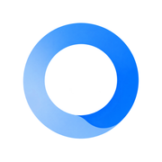
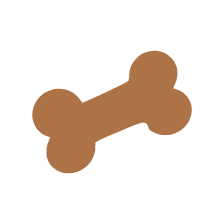

  <h1>Hi, I'm Jeanie 👋</h1>
  
Product Engineer &amp; Independent App Developer

  
I make apps that are useful, a little playful, and thoughtfully built.

  
Seoul · <a href="https://jeanie.dev">Website</a>

## Selected projects

  
  <strong><a href="https://organizly.org/">Organizly</a></strong> 
  A personal organizer for tasks, projects, and notes across iOS, macOS, and watchOS. Independently designed, developed, and shipped without a custom backend or account system. 
  SwiftUI · SwiftData · CloudKit · StoreKit 2

 

  
  <strong><a href="https://github.com/jeaniecho/rehearse">Rehearse</a></strong> 
  An AI-powered conversation coach for difficult workplace conversations, with interactive simulations, voice practice, and personalized feedback. Built with a resilient offline fallback. 
  Flutter · Dart · Node.js · Cloudflare Workers · OpenAI · RevenueCat 
  <a href="https://github.com/jeaniecho/rehearse">View source</a> · <a href="https://apps.apple.com/us/app/rehearse-conversation-coach/id6808087516">App Store</a> · <a href="https://play.google.com/store/apps/details?id=app.rehearse.rehearse">Google Play</a>

 

  
  <strong><a href="https://github.com/jeaniecho/waggle">Waggle</a></strong> 
  A tiny, local-first macOS desktop companion for focus and breaks, built around native window management, event-driven animations, and privacy-conscious input handling. 
  SwiftUI · AppKit · macOS · <a href="https://github.com/jeaniecho/waggle">View source</a>

 

  
  <strong><a href="https://apps.apple.com/kr/app/%EC%9A%B0%ED%8C%8C%EB%A3%A8-%EA%B0%80%EC%9D%B4%EB%93%9C-%EC%A1%B0%ED%95%A9-%EA%B3%84%EC%82%B0%EA%B8%B0/id6474457167">Wooparoo Guide</a></strong> 
  An independently built mobile reference app for a collection-based game. 
  <strong>25,000+</strong> downloads · <strong>3,000</strong> peak DAU · <strong>#4</strong> in the App Store Reference category

 

## What I work with

**Native development** · Swift, SwiftUI, AppKit  
**Cross-platform & web** · Flutter, Dart, Next.js  
**Infrastructure** · CloudKit, Firebase  
**Product engineering** · Stripe, RevenueCat, GA4, BigQuery, experimentation  
**Workflow & tooling** · Python, AI-assisted development, testing, iterative delivery
